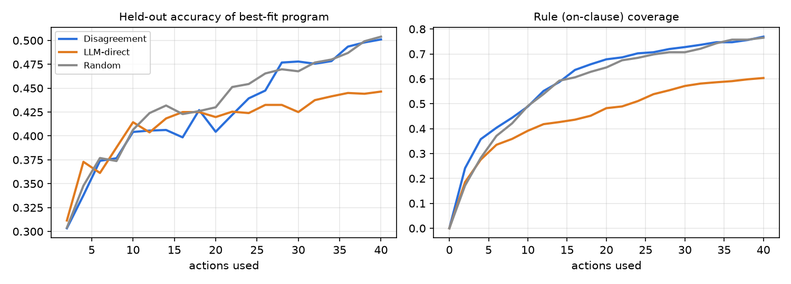

# Disagreement-driven exploration for code world models on AutumnBench

A small study of one idea: an agent keeps a handful of LLM-written world-model programs (`step(grid, action, mem) -> grid`) and acts wherever those programs disagree most. Does that make it explore like the humans in [AutumnBench](https://arxiv.org/abs/2510.19788), who use resets and waiting as deliberate experiments, and does it learn better world models than an LLM that picks actions itself?

Short answer: it beats the LLM picking actions directly, ties a random policy, and does not reset or wait the way humans do. The interesting part is why. Programs sampled from one model tend to share the same wrong assumptions, mostly that nothing changes on its own. Disagreement cannot see an error that every program shares. A stronger model (32B) makes the pool more uniform and the problem worse.

## Main numbers

8 deterministic Autumn environments (`grow`, `paint`, `disease`, `ice`, `egg`, `magnets`, `wind`, `gravity`), 40 actions per episode, Qwen2.5-Coder-7B-Instruct, 4 seeds (32 env × seed pairs):

| | Disagreement | LLM picks actions | Random |
|---|---|---|---|
| Held-out accuracy of best program | 0.50 | 0.45 | 0.50 |
| …on transitions where something changes | 0.32 | 0.20 | 0.29 |
| Rule (`on`-clause) coverage | 0.77 | 0.60 | 0.77 |
| Reset + no-op share of actions | 7.7 % | 26.8 % | 44.8 % |
| Took the action that would expose an error all programs share, when one existed | 4 % | 21 % | 20 % |

With exact hypotheses instead of LLM programs (the true program plus one-rule-deleted mutants), disagreement eliminates 70 % of the wrong ones within 10 actions; random eliminates 39 %. With Qwen2.5-Coder-32B, held-out accuracy does not improve. All six programs make the same wrong prediction on 31 % of test transitions (13 % with 7B), and disagreement's rule coverage falls below random's.



## Layout

```
cwm/                 agent, environment wrapper, analysis scripts
  agent.py           program pool, synthesis/repair, candidate actions, policies (disagree / llm / random)
  autumn_env.py      wrapper around the Autumn.cpp Python bindings
  progexec.py        sandboxed execution of LLM-written programs
  prompts.py         synthesis, repair and action-choice prompts
  llm.py             client for a vLLM OpenAI-compatible server
  heldout.py         held-out test trajectories
  run_all.py         runs (env, policy, seed) episodes in parallel
  control.py         positive control with exact hypotheses (true program + mutants)
  analyze.py, extra_stats.py, examples.py, validate_truth.py, resynth.py, crosseval.py, control_analyze.py
analysis_v2/         tables from the corrected 7B run, seeds 0–3
analysis_32b/        tables from the 32B run
analysis_control/    positive-control tables
figures/             plots
data/results.tar.gz  raw per-episode results for every run (2.4 MB)
scripts/             environment setup and vLLM launch
```

## Running it

Tested on Linux with V100 GPUs, Python 3.12, vLLM 0.6.6.

```bash
bash scripts/setup_env.sh            # venv, torch/vLLM, Autumn.cpp wheel, clones Autumn.cpp into third_party/
source .venv/bin/activate

# 1. start a model server (one V100 is enough for 7B)
bash scripts/serve_vllm.sh Qwen/Qwen2.5-Coder-7B-Instruct qwen-coder-7b 0 18731 &
export VLLM_URL=http://127.0.0.1:18731/v1/chat/completions VLLM_MODEL=qwen-coder-7b

# 2. run episodes (results/results_v2 by default)
python cwm/run_all.py --policies disagree,llm,random --seeds 0,1 --procs 16

# 3. analyse
python cwm/analyze.py && python cwm/extra_stats.py && python cwm/validate_truth.py

# positive control (no LLM needed except for the llm policy)
python cwm/control.py && python cwm/control_analyze.py
```

To redo the analysis on the published runs without a GPU, unpack the data first: `tar xzf data/results.tar.gz -C results/`. Then run any of the analysis scripts; they read `results/` by default, or the location in `CWM_RESULTS`.

7B episodes take about an hour each, and 16 run in parallel on one V100, so 48 episodes take about 3 h. The 32B run (4-bit GPTQ split over two V100s) took 6.3 h for 48.

## Things that bit me

- **Rendering has side effects in Autumn.cpp.** An interpreter that is not rendered after every step can evolve differently (`egg`, `magnets`, `gravity`). Any replay or simulation has to call `render_all()` after each step, as `autumn_env.py` now does.
- **Not every bundled program runs.** In the bundled tests, `mobileMagnet` segfaults and `sokoban` throws a runtime error. The interpreter also logs "On condition: …" to stderr on every step.
- **vLLM 0.6.6 on V100:**
  - prefix caching crashes (a Triton kernel assertion on Volta);
  - AWQ is refused, GPTQ works;
  - a seeded request with `n > 1` returns n identical samples, so only `n = 1` calls are seeded.
- **The `mem` argument is my addition.** The task specified `step(grid, action)`, but several environments have hidden state (current paint colour, gravity on/off, wind strength) that a pure grid-to-grid function cannot represent.

## Acknowledgements

Environments and interpreter: [Autumn.cpp](https://github.com/BasisResearch/Autumn.cpp) and AutumnBench by Warrier, Nguyen, Naim, Jain, Liang, Schroeder, Yang, Tenenbaum, Vollmer, Ellis and Tavares ([arXiv:2510.19788](https://arxiv.org/abs/2510.19788)). Models: Qwen2.5-Coder.
